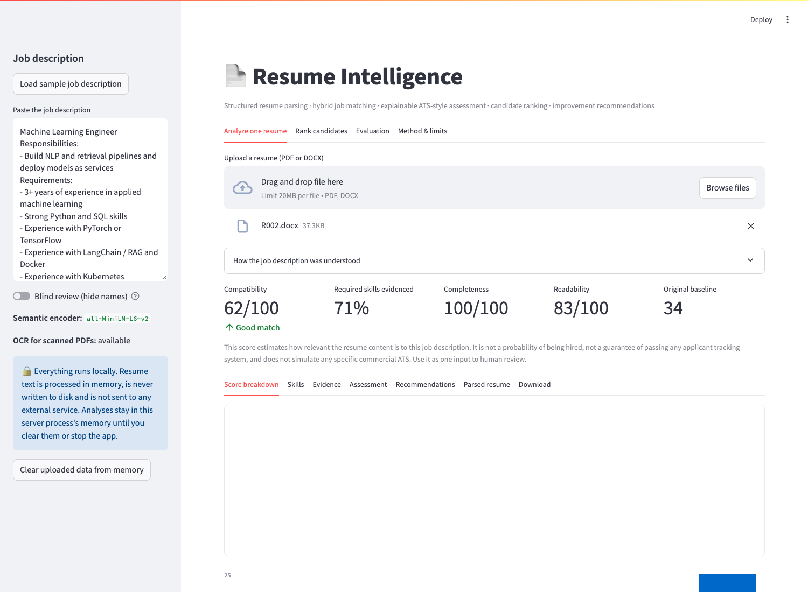
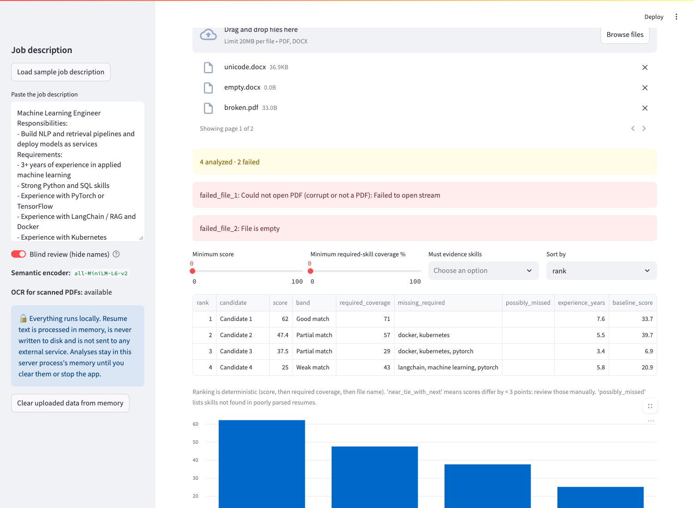

# ResumeIQ — explainable resume parsing, job matching and candidate ranking

**Problem.** Keyword overlap alone is a poor way to judge whether a resume fits a job: it rewards keyword lists, misses paraphrased skills, and can't say *why* a score is what it is. Recruiters also need to compare many resumes quickly without a black box deciding for them.

**This project** evolves an original prototype (PDF text + dictionary skills + TF-IDF) into a local, explainable system: it parses PDF/DOCX/scanned resumes into structured, confidence-labelled data; scores job relevance by combining skill evidence, semantic similarity, experience, projects, education and certifications; explains every score; ranks batches reproducibly; and suggests *honest* improvements. It needs no paid API and sends no data anywhere.

## Highlights
| | |
|---|---|
| 🔍 **Explainable** | Every score is broken into seven weighted factors with quoted resume evidence; gaps are separated from "could not be extracted" |
| 📄 **Robust parsing** | PDF, DOCX, scanned PDFs (OCR), two-column layouts; held-out extraction F1 **0.975** on layouts unseen during development |
| 🛡️ **Resists keyword stuffing** | A keyword-stuffed resume that the original method ranked *first* is ranked *last* by the hybrid |
| ⚖️ **Fairness-tested** | Scores are provably invariant to name, contact details, institution, education dates, employment gaps and hobbies (automated tests) |
| 👥 **Recruiter workflow** | Batch ranking, filters, comparison, blind-review mode, CSV/HTML/JSON/Markdown exports |
| ✍️ **Honest recommendations** | Tagged *improve existing* / *add if true* / *develop* / *restructure*; never invents skills or numbers |
| 🔒 **Private by design** | Fully local, in-memory, no telemetry, no paid API |
| ✅ **Tested** | 75 automated tests, including browser end-to-end tests of the real app |

> **Use as decision support.** Scores estimate how relevant resume content is to a job description; they are not hiring probabilities or an ATS pass rate, and a human should review results. See [Known limitations](#known-limitations) and [Privacy](#privacy).




## Features
| Capability | Where |
|---|---|
| Parsing: contact, links, normalised skills (with *where* and *how* each appears), education, experience with dates/estimated years, projects, certifications; per-item confidence; warnings instead of guesses | `resume_intel/parser.py`, `skills.py` |
| PDF, DOCX, scanned PDF (Tesseract OCR), two-column layouts, corrupt/encrypted/empty files rejected with clear messages | `resume_intel/extraction.py` |
| Hybrid matching with required/preferred skills, "X or Y" alternatives, evidence, and the original method kept as a baseline | `matching.py`, `jobs.py`, `baseline.py` |
| Explainable assessment: score breakdown, strengths, gaps, **uncertainties** (missing vs not extracted), ATS-style completeness/readability checks | `assessment.py` |
| Recommendations tagged `improve_existing` / `add_if_true` / `develop` / `restructure`; never invents skills, outcomes or numbers | `recommendations.py` |
| Batch ranking, filters, sorting, side-by-side comparison, **blind-review mode** (also anonymises exports), CSV/HTML/JSON/Markdown reports | `app.py`, `pipeline.py`, `reports.py` |
| Reproducible evaluation with separated development / validation / held-out test tiers | `evaluation/` |

## Install and run
```bash
python -m venv .venv && source .venv/bin/activate
pip install -r requirements.txt
streamlit run app.py
```
* **Semantic model.** `all-MiniLM-L6-v2` is used if it is already in your Hugging Face cache; by default nothing is downloaded. To fetch it once: `RESUME_INTEL_ALLOW_DOWNLOAD=1 python -c "from resume_intel.semantic import get_encoder; print(get_encoder().name)"`. Without it the app uses a weaker built-in fallback encoder and says so in the sidebar and in every result.
* **OCR (optional).** Install the Tesseract binary (`brew install tesseract` / `apt install tesseract-ocr`) plus `pytesseract` and `pillow` (in `requirements.txt`). Without Tesseract, image-only PDFs are rejected with a message saying so. Only the first 6 pages are OCR'd; OCR'd results are flagged lower-confidence.
* Python 3.10+ (developed on 3.13). Streamlit telemetry is disabled in `.streamlit/config.toml`.

## Try it
`samples/` holds a job description and fictional resumes (generated by `python -m evaluation.make_samples`): `strong_match.docx`, `paraphrased_skills.pdf` (describes skills without keywords), `student_projects.pdf`, `missing_one_essential.pdf`, `keyword_stuffed.pdf` and `scanned_image_only.pdf` (OCR). In the app: *Load sample job description* → upload one resume (single analysis) or all of them (ranking tab).

```python
from resume_intel.jobs import parse_job_description
from resume_intel.pipeline import analyze_file
jd = parse_job_description(open("samples/sample_job_description.txt").read())
a = analyze_file(open("samples/resumes/strong_match.docx", "rb").read(), "strong_match.docx", jd)
print(a.match.score, a.match.band, [s.skill for s in a.match.missing_required])
```
Sample outputs (sample JD, shipped resumes): strong_match 55.8 (good), missing_one_essential 45.7, scanned_image_only 40.5 (via OCR), paraphrased_skills 40.3, student_projects 39.4, keyword_stuffed 29.2 (weak). The original method (scores 8–29) ranks `keyword_stuffed.pdf` **first** and the paraphrased/student/scanned resumes last; the hybrid ranks the stuffed resume last. (One illustrative case, not a benchmark.)

## Architecture
```
app.py (Streamlit) ─▶ resume_intel/pipeline.py ─▶ extraction ─▶ parser ─▶ jobs ─▶ matching ─▶ assessment + recommendations ─▶ reports
                       skills.py (taxonomy) · semantic.py (MiniLM | fallback) · baseline.py (original method, unchanged in behaviour)
evaluation/  synthetic.py (dev) · heldout.py (validation/test) · run*.py · results/        tests/  unit + fairness + robustness + browser e2e
```
**Matching in one paragraph.** Seven dimensions — skill alignment 0.30, experience 0.25, semantic similarity 0.20, projects 0.10, education 0.05, certifications 0.05, TF-IDF 0.05 — are scored 0-1 and combined; non-applicable dimensions are dropped and weights renormalised. A skill earns 1.0 if demonstrated in experience/projects, 0.9 if implied (PyTorch → deep learning), 0.5 if only listed in a skills list, 0.4 if only a related skill is present, 0 if missing. Missing-but-possibly-unparsed items are reported separately as *uncertainties*. Name, contact details, institution names, education dates, hobbies and references never enter scoring. Full formulas, the diagnosis behind the weights, rejected experiments and fairness/privacy details: [`docs/METHODOLOGY.md`](docs/METHODOLOGY.md).

## Tests
```bash
pip install -r requirements.txt && pip install playwright   # playwright only for the browser tests
python -m pytest -q                       # everything (browser tests auto-skip if no Chromium is found)
python -m pytest -q --ignore=tests/e2e    # fast unit tests only
```
Browser tests use Playwright with headless Chromium (set `CHROMIUM_PATH` if it is not in the Playwright cache; `E2E_SCREENSHOTS=1` regenerates the screenshots above). They drive the real Streamlit app: single upload (DOCX), multi-upload with a corrupt and an empty file, score tabs, HTML/JSON/CSV downloads, blind review (names absent from the page and from CSV/JSON exports), Unicode resume, malformed upload, missing job description, scanned PDF with OCR, scanned PDF with OCR disabled, and the Evaluation tab.

## Evaluation
All evaluation data are synthetic (no real labelled benchmark is bundled, so real-world accuracy has not yet been measured). Three tiers are kept apart (protocol in [`evaluation/README.md`](evaluation/README.md)): *development* (used to build), *validation* (a first held-out round, used for failure analysis, so optimistic), and a **held-out test** (fresh seed, two new layouts incl. a two-column PDF; 140 resumes × 10 jobs; run once on frozen code).

**Held-out test — ranking** (mean over 10 jobs; bootstrap 95% CI over jobs for the difference from the original baseline):

| System | nDCG@10 | MAP | Δ nDCG@10 vs baseline |
|---|---|---|---|
| Original baseline (dictionary + TF-IDF) | 0.694 | 0.640 | – |
| TF-IDF only | 0.756 | 0.707 | +0.063 [+0.025, +0.104] |
| Skills only | 0.682 | 0.692 | −0.012 [−0.118, +0.092] |
| Hybrid v1 (initial config) | 0.776 | 0.737 | +0.082 [−0.009, +0.176] |
| **Final hybrid (MiniLM)** | **0.762** | **0.704** | **+0.068 [−0.020, +0.161]** |

*"Hybrid v1" is the first scoring configuration, kept as a reference point; the final configuration differs only in credit values and weights (see [METHODOLOGY](docs/METHODOLOGY.md)).*

**Reading the table:** the final hybrid scores above the original baseline on average (+0.068 nDCG@10); with only 10 synthetic jobs this gain is not statistically established, plain TF-IDF scored similarly, and the configuration was fixed before the test rather than picked from it. Where the hybrid clearly behaves differently (mean rank among 140 candidates, lower is better for good candidates): exact fits 2.4 vs 6.0, paraphrased 14.1 vs 22.4, near-misses 6.6 vs 14.7 (a **weakness**: near-misses, true grade 1, still rank ahead of paraphrased (grade 3) and project-only (grade 2) candidates, as they did under the baseline), keyword-stuffed 22.6 vs 13.7 (pushed down, as intended), project-only candidates 15.6 vs 14.3 (no gain). Its measured value is therefore mainly **explainability, resistance to keyword stuffing and structured parsing**, not a proven ranking breakthrough.

**Held-out test — extraction** (new layouts incl. two-column and unconventional headings): overall excluding skills P = 0.983, R = 0.968, F1 = 0.975 (ambiguous resumes F1 = 0.955). Weak spots: certifications precision 0.695 (extra lines swept into certifications under odd headings), project names recall 0.855, institution/degree recall 0.921; tools outside the taxonomy are never found (0/38). Round-1 (first run, before any fix) was markedly worse (F1 0.89), mostly on unfamiliar layouts, and those failures drove real parser fixes (see METHODOLOGY).

Development set: baseline 0.760 → hybrid 0.870 nDCG@10 (optimistic: built on this data). Speed ≈ 0.02 s/resume after model load, 0% failures on valid synthetic files, all nine malformed-input cases handled gracefully (`results/DEV_RESULTS.md`).

Reproduce: `python -m evaluation.run_heldout` (test), `python -m evaluation.run` (development), `python -m evaluation.select_config`.

## Privacy
Resumes are processed locally and in memory; the code writes nothing to disk and contacts no external service (the only optional network use is the one-time embedding-model download you explicitly enable). Analyses remain in server memory until cleared (sidebar button) or the app stops. Blind-review mode strips names, contact details, file names and raw text from the UI and exports. Repository samples and test fixtures are fictional. Do not commit real resumes. See METHODOLOGY for details.

## License
MIT — see [LICENSE](LICENSE).
